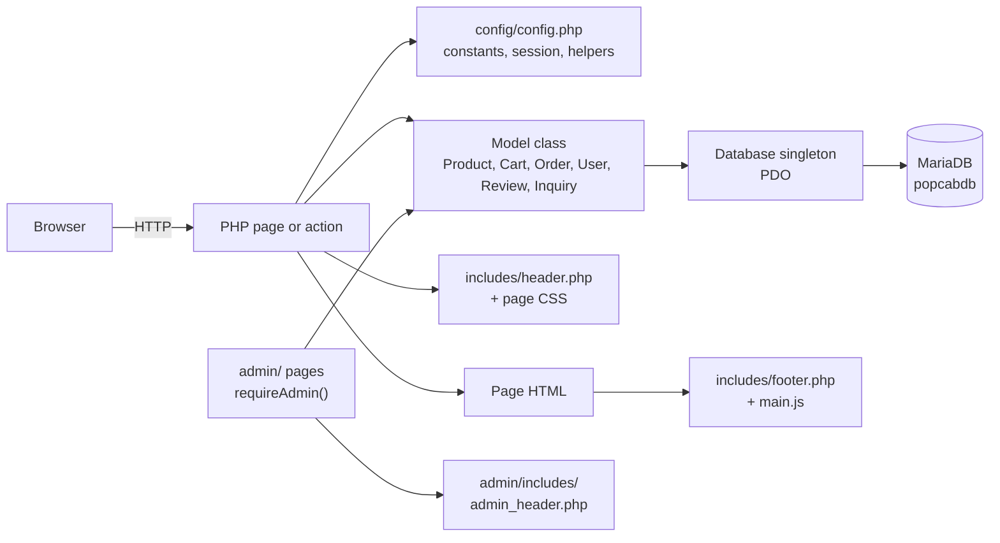
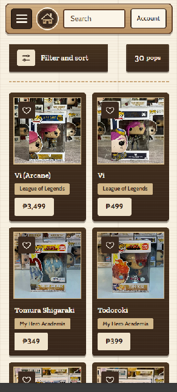

# The Pop Cabin Catalog

A mobile-first, server-rendered PHP/MySQL storefront that turns The Pop Cabin's Facebook-only Funko Pop feed into a searchable catalog with a cart, checkout, reviews, and an admin panel.

> **OOP Final Project** · Section 21-ITEN-02 · November 18, 2026

## Overview

The Pop Cabin is a Funko Pop collectibles shop that currently sells through a single Facebook page. Its merchandise sits in a disorganized feed, and product details and stock are buried under older posts. This project gives the shop a dedicated, searchable catalog for local collectors, with a cart, checkout, reviews, and an admin panel. It is the OOP final project for section 21-ITEN-02 and the storefront for The Pop Cabin.

## Objectives

The final deck states four objectives:

- Catalog each Pop by name, genre, price, rating, and stock.
- Search by name; filter by genre and availability.
- Sort by price, rating, or name.
- Give admins add, edit, and stock controls.

The current code implements search, genre/price filtering, price/name sorting, stock display, and admin stock controls. Rating sorting and a public availability filter are not in the public UI; see [Notes for Review](#notes-for-review-source-discrepancies).

## Features

### Storefront

- **Home:** hero with live product and review counts, collection tiles (Movies, Anime, Games), team cards, and social links.
- **Catalog:** 16 products per page, out-of-stock ribbons, and shop cards showing photo, name, franchise, stock, and price.
- **Search and filters:** header search and shop search match pop or franchise names; filters cover franchise, collection, and min/max price; sort by newest, price, or name.
- **Product page:** photo zoom, stock, price, star rating summary, description, related pops, and a 404 state.
- **Reviews:** signed-in customers can post one review per pop (optionally anonymous); the page shows the average and count, the latest three reviews, and a "see all" link.
- **Favorites:** heart toggles persist in `localStorage` for that browser only; there is no account-level favorites list.

### Cart, checkout, and accounts

- **Cart:** database-backed for guests and users; a guest cart is claimed or merged at login; quantities are capped by stock; lines can be removed; the summary shows flat ₱15 shipping, free at ₱100 or more.
- **Checkout:** login required; shipping fields prefilled from the profile; order summary.
- **Orders:** `Order::create()` writes `orders` and `order_items`, decrements stock, and rolls back the whole order if any line is short; the cart is cleared and the customer sees the order detail.
- **Accounts:** register (first/last name, email, password, terms), auto-generated username, auto-login, login with optional 30-day "remember me", logout, profile editing, and order history.
- **Contact:** message form with an optional PNG/JPG/JPEG/DOCX/TXT/MD attachment up to 10 MB; saved to `inquiries` and `storage/inquiries/`.
- **Content pages:** About (photo gallery, copy, map, and address from `config/content.php`); System Mechanics and Terms are placeholder shells.

### Admin

- **Dashboard:** product, user, order, and out-of-stock counts.
- **Products:** list with search, franchise/stock filters, pagination, edit/delete, and low/out-of-stock pills; create/edit form covers image, name, franchise (pick one or add a new one inline), edition, price, stock, collections (tick pills or add a new category inline), description, and a stored featured flag (edit only; not currently rendered on the home page).
- **Delete safety:** confirmation screen; deletion is blocked when an existing order references the product, and the UI suggests setting stock to 0 instead.
- **Orders:** list with customer, date, item count, total, and status updates (`pending`, `processing`, `shipped`, `delivered`, `cancelled`).
- **Users:** read-only list with role pill and pagination.
- **OOP demo:** `admin/oop_demo.php` calls `describe()` on four models; it is not linked in the admin menu.

### Platform and security

- **No framework, no build step, no CDN:** server-rendered PHP, CSS custom properties, and vanilla JavaScript; fonts are self-hosted.
- **Responsive:** mobile-first around 390 px, breakpoints at 700 and 1000 px, maximum content width 1200 px.
- **Progressive enhancement:** pages and form submissions work without JavaScript; JavaScript adds the mobile menu, carousels, toasts, AJAX add-to-cart, image zoom, file previews, and client-side per-field checkout validation.
- **Security:** PDO prepared statements, `e()` output escaping, CSRF tokens on POST forms, `password_hash`/`password_verify`, session hardening, `requireLogin()`/`requireAdmin()`, safe `next` redirects, and upload type/size checks.
- **Accessibility:** skip link, labels, `aria-invalid`/`aria-describedby` field errors, focus-visible styles, Escape-to-close menus, and reduced-motion support.

## Tech Stack

| Area | Technology | Notes |
| --- | --- | --- |
| Language | PHP 8.0+ | Uses `match`, union return types, typed properties, `str_contains`, and `str_starts_with`. Local XAMPP runs 8.2.12; the deck and SQL dump report 8.5.12. |
| Database | MariaDB 10.4.32 / MySQL-compatible | InnoDB, `utf8mb4`; database `popcabdb`; dump in `sql/popcabdb.sql`. |
| DB access | PDO | `Database` singleton in `config/database.php`; prepared statements in every model. |
| Web server | Apache 2.4.58 (XAMPP) | The PHP built-in server also works for local testing. |
| Frontend | Server-rendered HTML, CSS, vanilla JavaScript | No framework and no build step. |
| Styling | CSS custom properties | `assets/css/tokens.css` (Figma tokens) plus shared and per-page CSS. |
| Fonts | Fredoka + Nunito | Self-hosted `.ttf` files in `assets/fonts/`; `@font-face` in `assets/css/base.css`. |
| Dependencies | None | No Composer, npm, CDN, Bootstrap, or Tailwind. |
| Tooling | Git, phpMyAdmin, Figma/FigCraft | Figma-to-CSS rules in `docs/DESIGN.md`; mobile PNG references in `docs/figma/`. |
| Tests | No automated suite | Manual cases are documented in the final deck; see [Testing](#testing). |

## System Design

The app is a server-rendered PHP application with a small model layer:

1. `config/config.php` loads constants, starts the session, requires the PDO singleton, and loads helper functions.
2. Each page or action instantiates the model classes it needs, reads `$_GET`/`$_POST`, and calls model methods. Pages do not write SQL directly.
3. Public pages include `includes/header.php`, render their HTML, and include `includes/footer.php`. Admin pages use `admin/includes/admin_header.php` and `admin_footer.php`.
4. Writes use POST, redirect, GET with a flash message. Orders and product deletes use database transactions.



### OOP layer

`Database` is a private-constructor singleton. `BaseModel` is abstract and owns the protected PDO connection; the six models extend it and implement `table()`. The deck's four concepts map to the code as follows:

| Concept | Where it lives |
| --- | --- |
| Encapsulation | `BaseModel::$db` is `protected`; `Cart::$cartId` is `private` |
| Inheritance | `Product`, `Cart`, `Order`, `User`, `Review`, and `Inquiry` extend `BaseModel` and inherit `$db`, the constructor, and `countAll()` |
| Abstraction | `abstract class BaseModel` with `abstract protected function table()` |
| Polymorphism | `describe()` is overridden by `Product`, `Order`, and `User`; `Product::countAll()` adds filters; `admin/oop_demo.php` calls `describe()` |
| Singleton | `Database::getInstance()` with a private constructor |

`Product::delete()` and `Order::create()` use transactions. Not used: interfaces, namespaces, or an autoloader; model files are loaded with `require_once`.

### Data model

| Area | Tables | Relationship |
| --- | --- | --- |
| Catalog | `categories` (franchises), `products`, `collections` (category pills), `product_collections` | A product has one franchise and many collections (M:N). |
| Accounts | `users` | `user_role` is `customer` or `admin`. |
| Cart | `carts`, `cart_items` | One cart per user or guest session; guest carts use `user_id = 0` plus a session token and are merged at login. |
| Orders | `orders`, `order_items` | `order_items` snapshots product name and price; a product referenced by an order cannot be deleted. |
| Reviews | `reviews` | Unique `(product_id, user_id)`: one review per customer per pop. |
| Contact | `inquiries` | Optional `user_id`; attachments are stored under `storage/inquiries/`. |

## Project Structure

```text
the-pop-cabin/
├── index.php                  Home: hero, counts, collection tiles, team
├── shop.php                   Catalog: search, filters, sort, pagination
├── product.php                Product detail: cart, reviews, related
├── cart.php                   Cart and shipping summary
├── checkout.php               Shipping form and order summary
├── order_detail.php           Customer/admin order view
├── account.php                Profile and order history
├── login.php                  Sign in
├── register.php               Sign up
├── logout.php                 Session teardown
├── contact.php                Inquiry form with optional attachment
├── about.php                  About, gallery, map, address
├── mechanics.php              Placeholder page
├── terms.php                  Placeholder page
├── actions/                   POST handlers: cart, order, review
├── admin/                     Dashboard, products, orders, users, OOP demo
│   └── includes/              Admin header and footer
├── classes/                   BaseModel plus six models
├── config/                    Config, PDO singleton, editable content
├── includes/                  Public header/footer, card partial, helpers
├── assets/
│   ├── css/                   Tokens, shared styles, per-page styles
│   ├── fonts/                 Fredoka and Nunito (self-hosted)
│   ├── img/                   Logo, backgrounds, team portraits, icons
│   └── js/main.js             Progressive enhancement
├── docs/
│   ├── DESIGN.md              Design tokens and Figma-to-CSS rules
│   ├── figma/                 Mobile reference exports
│   └── presentation/          Exported deck screenshot
├── ppt/                       Final OOP presentation (.pptx)
├── sql/popcabdb.sql           Schema and seed data
├── uploads/products/          Product photos (writable)
├── storage/inquiries/         Contact attachments (created at runtime)
├── AGENTS.md                  Design-to-code rules for agents
└── README.md                  This file
```

## Getting Started

### Prerequisites

- PHP 8.0 or newer with the `pdo_mysql` extension.
- MySQL 5.7+ or MariaDB 10.2+ (the dump was generated on MariaDB 10.4.32).
- Apache 2.4 (XAMPP is the documented setup) or the PHP built-in server.
- Write access to `uploads/products/` (exists) and to the project root so `storage/inquiries/` can be created.
- A modern browser.

### Installation

1. **Put the project in the web root.** With XAMPP, the expected path is:

   ```powershell
   C:\xampp\htdocs\the-pop-cabin
   ```

   Alternatively, clone it:

   ```powershell
   git clone https://github.com/KharoPT/the-pop-cabin.git C:\xampp\htdocs\the-pop-cabin
   ```

   The folder name must match `SITE_URL` in `config/config.php`.

2. **Start Apache and MySQL** from the XAMPP Control Panel.

3. **Import the database.** In phpMyAdmin (`http://localhost/phpmyadmin`), open the **Import** tab at the server level, choose `sql/popcabdb.sql`, and run it. The dump creates `popcabdb` and switches to it. It seeds 30 products across 11 franchises, plus 3 collections, 2 accounts, 6 carts, and 1 review; there are no orders or inquiries.

   CLI alternative (run it through `cmd` so the `<` redirect works in PowerShell):

   ```powershell
   cmd /c "C:\xampp\mysql\bin\mysql.exe -u root < C:\xampp\htdocs\the-pop-cabin\sql\popcabdb.sql"
   ```

   If `popcabdb` already exists, the dump's `CREATE DATABASE popcabdb;` line fails. Back up the existing database first, then import into it with that line removed, or drop and recreate it.

4. **Check the configuration** in `config/config.php` (see the table below). The defaults match a stock XAMPP install.

5. **Open the site:**

   ```text
   http://localhost/the-pop-cabin/
   ```

No `composer install`, `npm install`, or build step is required.

### Configuration

The app has no `.env` file. Settings are PHP constants in `config/config.php`:

| Constant | Default | Purpose |
| --- | --- | --- |
| `SITE_URL` | `http://localhost/the-pop-cabin` | Base URL; must match the folder, with no trailing slash |
| `DB_HOST` | `127.0.0.1` | Database host |
| `DB_NAME` | `popcabdb` | Database name |
| `DB_USER` | `root` | Database user |
| `DB_PASS` | `''` | Database password (empty on a stock XAMPP) |
| `SITE_CURRENCY_SYMBOL` | `₱` | Price symbol |
| `FREE_SHIPPING_THRESHOLD` | `100` | Free shipping at or above this subtotal |
| `FLAT_SHIPPING_FEE` | `15` | Flat shipping fee below the threshold |
| `PRODUCTS_PER_PAGE` | `16` | Shop page size |
| `ADMIN_PER_PAGE` | `20` | Admin page size |
| `MAX_PRODUCT_IMAGE_MB` | `5` | Product image upload limit |
| `MAX_CONTACT_FILE_MB` | `10` | Contact attachment limit |

Other notes:

- Timezone is `Asia/Manila` (`date_default_timezone_set`).
- `display_errors` is `1` for development. Set it to `0` before a public demo or deployment.
- `storage/inquiries/` is created automatically on the first contact attachment; ensure the parent directory is writable.
- After schema or seed changes, export `popcabdb` and replace `sql/popcabdb.sql` so the dump stays current.

### Run

**XAMPP (Apache):**

```text
http://localhost/the-pop-cabin/
```

Admin: `http://localhost/the-pop-cabin/admin/index.php` (requires an account with `user_role = 'admin'`).

**PHP built-in server (testing only):**

```powershell
cd C:\xampp\htdocs\the-pop-cabin
C:\xampp\php\php.exe -S localhost:8000
```

Before starting it, set `SITE_URL` to `http://localhost:8000` in `config/config.php`. The built-in server does not read Apache `.htaccess`, but this app does not require URL rewriting.

If the page says "Database connection failed", check `DB_HOST`, `DB_NAME`, `DB_USER`, and `DB_PASS`, and confirm `popcabdb` was imported. If CSS or links are missing, check `SITE_URL`.

### Seeded accounts

The dump creates two accounts:

| Username | Email | Role |
| --- | --- | --- |
| `admin` | `admin@gmail.com` | `admin` |
| `customer` | `customer@gmail.com` | `customer` |

<!-- TODO: The dump stores only password hashes; no plaintext demo password is recorded in the repository. Add the demo password to the team handoff, or reset it locally before the presentation. -->

## Usage

1. **Browse the catalog.** Open `/shop.php`, type in the header search, or use **Filter & Sort** to choose a franchise, category, price range, and sort order. The grid shows 16 pops per page; out-of-stock cards keep their ribbon.
2. **Open a pop.** Click a card to see the photo, stock, price, rating, description, and related pops. Use the zoom button for a larger image.
3. **Add to cart.** On the product page, press **Add to Cart**. The AJAX call updates the cart badge and shows a toast; without JavaScript, the form posts normally. The cart caps quantities at available stock.
4. **Check out.** Open `/cart.php`, adjust quantities, and press **Proceed to Checkout**. Checkout requires an account; shipping fields are prefilled from the profile. Press **Place Order** to create the order and decrement stock in one transaction.
5. **Sign in or register.** `/login.php` and `/register.php`. Registration asks for first/last name, email, password, and terms agreement; the username is generated from the email. "Remember me" keeps the session cookie for 30 days.
6. **Manage your account.** `/account.php` edits the profile and lists order history; `/order_detail.php?order=...` shows one order.
7. **Send an inquiry.** `/contact.php` accepts a message and an optional attachment up to 10 MB; the file is stored in `storage/inquiries/` and the message in `inquiries`.
8. **Admin.** Sign in with an admin account, open `/admin/index.php`, then use **Products** to add/edit/delete, **Orders** to change status, and **Users** to view accounts. `admin/oop_demo.php` shows the OOP demo (not in the menu).

## Screenshots / Demo



*Mobile catalog (Figure 6 in the final deck). The deck's only raster image is this screenshot; there are no diagrams or charts to export.*

- [View the presentation](ppt/The-Pop-Cabin-OOP-Final.pptx) (10 slides, with speaker notes)
- Design reference frames: [Home](docs/figma/Home-Mobile.png), [Collection](docs/figma/Collection-Mobile.png), [Product](docs/figma/Product-Profile-Mobile.png), [Basket](docs/figma/Basket-Mobile.png); full set in [`docs/figma/`](docs/figma/).

<!-- TODO: Add a short demo video or animated GIF and screenshots of the admin dashboard, orders, and checkout flow; the deck only includes the mobile catalog. -->

## Testing

There is no automated test suite or test runner in the repository (`composer.json`, `package.json`, and `phpunit.xml` are absent). All PHP files pass a syntax check with XAMPP PHP 8.2.12:

```powershell
Get-ChildItem -Recurse -Filter *.php | ForEach-Object { C:\xampp\php\php.exe -l $_.FullName }
```

The final deck documents these manual acceptance cases, all reported as **Pass**:

| Test | Expected result | Result |
| --- | --- | --- |
| Admin login | Dashboard opens | Pass |
| Add product | Appears on catalog | Pass |
| Edit product | Changes on catalog | Pass |
| Delete product | Disappears from catalog | Pass |
| Invalid price | Error, nothing saved | Pass |
| Sort products | Sorted by price or name | Pass |
| Filter products | Filtered by franchise or category | Pass |

The deck notes that the paper reports nine tests and lists seven on the slide. The "Pass" results are the paper's reported results, not a re-run of an automated suite.

## Future Improvements

The deck's conclusion and speaker notes point to this roadmap:

- **Payment gateway:** checkout currently records an order without collecting payment.
- **Order dashboard with status updates:** already implemented in `admin/orders.php`; the deck still lists it as future work.
- **Scheduled promotions:** the current `is_featured` flag is stored but not rendered as a promotion on the home page.
- **Email notifications:** no mail is sent for orders, inquiries, or password resets.
- **Password reset:** the "Forgot Password?" link on `/login.php` is inactive.
- **Persistent favorites:** hearts live in `localStorage` and do not follow the account across devices.
- **Shipping integration:** shipping is a flat fee (`FLAT_SHIPPING_FEE`) or free at or above `FREE_SHIPPING_THRESHOLD`; there is no carrier or live-rate integration.

Also visible in the code: admin user management is read-only, and there is no admin screen for `inquiries` or `reviews`.

## Team / Credits

**The Pop Cabin** is the shop behind this project. This is the OOP final project for section **21-ITEN-02** (November 18, 2026). Course instructor: **Sir Roberth Lloren** (per the deck's speaker notes).

| Name | Role |
| --- | --- |
| Abalos, Jamon Ray T. | Database Developer |
| Caburnay, Rey Alexis R. | Leader, Full Stack |
| DeGuzman, Chryswynne C. | Frontend Developer |
| Estrada, Gian Ernest D. | Backend Developer |

The deck's title slide lists the names; the roles come from the team cards in `index.php`.

## Notes for Review: Source Discrepancies

The deck and the code disagree in these places, or the deck's claim is not backed by files in the repository. The code is treated as the source of truth for behavior; the deck remains the source for purpose, audience, and roadmap.

| # | Final deck | Current code |
| --- | --- | --- |
| 1 | "No ... admin order screen yet" (slide 9) | `admin/orders.php` lists orders and updates status; it is linked in the admin menu. |
| 2 | Admins "manage users" (slide 4) | `admin/users.php` is read-only (list, role pill, pagination). |
| 3 | Sort by rating (slide 3) | `Product::getAll()` supports newest, price ascending/descending, and name; no rating sort. |
| 4 | Filter by availability (slide 3) | Public `shop.php` has franchise, category, price, search, and sort; no stock filter. `admin/products.php` has one, and `Product` supports a `stock` filter internally. |
| 5 | Visitors "view promotions" (slide 4) | Only the `is_featured` flag and admin toggle exist; `Product::getFeatured()` is not called by any page, so no promotion or featured section renders. |
| 6 | "No payment, shipping ... yet" (slide 9) | No payment is collected, but cart, checkout, and order calculation use a flat ₱15 shipping fee, free at ₱100 or more. There is no carrier integration. |
| 7 | Order dashboard with status updates is future work (slide 9 notes) | Already implemented in `admin/orders.php`. |
| 8 | "Every test ... passed" (slide 8) | No automated tests or result artifacts are checked in; this README reports the deck's manual cases as reported, not re-run. |

Other code-level notes for the demo:

- `mechanics.php` and `terms.php` are placeholders ("This page has not been published yet"); "Forgot Password?" and "Privacy Policy" are inactive links.
- `product.php` shows Dibs, Steal, Claim, and Cabin Lock tabs, but they only relabel or disable the Add to Cart button; no reservation flow exists.
- `inquiries` and `reviews` are saved but have no admin moderation or read screens.
- Contact attachments are written to `storage/inquiries/`; no `.htaccess` deny rule exists for `storage/` or `uploads/` in this checkout (only `classes/.htaccess`). Add one before deploying to a public host.
- At the time of writing, the deck is untracked in git (`ppt/`), so the presentation link will not exist in a fresh clone until it is added.
- At the time of writing, the exported screenshot `docs/presentation/mobile-catalog.png` is also new; add it to git with this README.
- No `LICENSE` file is present.

### Assumptions

- The setup target is XAMPP on Windows at `C:\xampp\htdocs\the-pop-cabin`, with the default `root` / empty-password database account.
- Seed counts come from `sql/popcabdb.sql`, not the live database; the live database can differ.
- Team roles come from `index.php`; the deck's title slide lists the names only.
- The deck reports PHP 8.5.12; the local XAMPP runtime is 8.2.12. The code only requires the PHP 8.0 features listed above.

<!-- TODO: Add a LICENSE file and confirm the license with the client and team. -->
<!-- TODO: Add the demo password or a password-reset step to the team handoff; the SQL dump stores only hashes. -->
