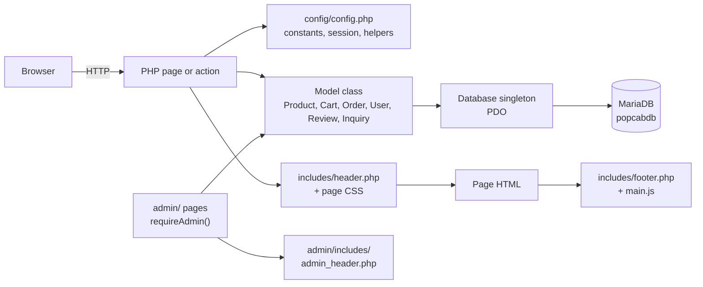

# The Pop Cabin Catalog

A server-rendered PHP/MySQL storefront for The Pop Cabin: a searchable Funko Pop catalog with a cart, checkout, orders, reviews, and an admin panel.

## Overview

The Pop Cabin is a Funko Pop collectibles shop that sells through a single Facebook page, where stock and product details get buried under newer posts. This project gives the shop a dedicated catalog: customers can search and filter the collection, see price and stock, add pops to a cart, check out into a database-backed order, and leave a review. Admins manage products, stock, and order status from `/admin/`.

It is a student project built without a framework, a package manager, or a build step: plain PHP pages, a small model layer over PDO, CSS custom properties, and vanilla JavaScript.

## Features

### Storefront

- **Home (`/index.php`):** hero with live product and review counts, category tiles from the `collections` table, a "Meet the Devs" team band, social links, and a CTA that changes for signed-in customers.
- **Catalog (`/shop.php`):** search by pop or franchise name, filter by franchise and collection, min/max price, sort by newest, price, or name. 16 pops per page, out-of-stock ribbon, empty state, and pagination.
- **Product (`/product.php?slug=...`):** photo, stock, price, star summary, description, related pops, a zoom dialog, and a 404 state for unknown slugs.
- **Reviews:** signed-in customers can post one review per pop (enforced by a unique key on `reviews(product_id, user_id)`), optionally anonymous. The page shows the average, the count, and the latest three, with a "see all" view.
- **Favorites:** the heart toggles are stored in `localStorage` for that browser only; there is no account-level favorites list.
- **Contact (`/contact.php`):** message plus an optional PNG/JPG/JPEG/DOCX/TXT/MD attachment up to 10 MB, stored in `inquiries` and `storage/inquiries/`.
- **Content pages:** About (photo gallery, copy, map embed, and address read from `config/content.php`); System Mechanics (documents the four bid moves — Dibs, Steal, Claim, Cabin Lock); Terms of Service is a placeholder.

### Cart, checkout, and accounts

- **Cart (`/cart.php`):** database-backed for guests and users. A guest cart (`user_id = 0` plus a session token) is claimed or merged at login. Quantities are capped at stock, and the checkout button is blocked while any line asks for more than is available.
- **Shipping:** flat `₱15`, free at a subtotal of `₱100` or more (`FLAT_SHIPPING_FEE` / `FREE_SHIPPING_THRESHOLD`).
- **Checkout (`/checkout.php`):** login required; shipping fields are prefilled from the profile.
- **Orders:** `Order::create()` writes `orders` and `order_items`, decrements stock, and rolls back the whole order if any line is short. The cart is cleared and the customer lands on the order detail page.
- **Accounts:** register (first/last name, email, password, terms; username generated from the email; auto-login), sign in with an optional 30-day "remember me", sign out, profile editing, and order history.

### Admin (`/admin/`)

- **Dashboard:** product, user, order, and out-of-stock counts.
- **Products:** list with search, franchise/stock filters, and pagination; create/edit form covering photo, name, franchise (select an existing one or add a new one inline), edition, price, stock, collections (tick pills or add a new category inline), description, and a featured flag (edit screen only).
- **Delete safety:** a confirmation screen; deletion is blocked when an existing order references the product, and the UI suggests setting stock to 0 instead.
- **Orders:** every order with customer, date, item lines, shipping address, and a status control (`pending`, `processing`, `shipped`, `delivered`, `cancelled`).
- **Users:** read-only list with role pill and pagination.
- **OOP demo:** `admin/oop_demo.php` calls `describe()` on four models; it is not linked in the admin menu.

### Platform and security

- **No framework, build step, or CDN:** server-rendered PHP, CSS custom properties, vanilla JavaScript, self-hosted fonts.
- **Progressive enhancement:** every form posts normally without JavaScript; JavaScript adds the menus, toasts, AJAX add-to-cart, image zoom, file previews, and client-side checkout validation.
- **Security:** PDO prepared statements, `e()` output escaping, a CSRF token on every POST form, `password_hash`/`password_verify`, session id regeneration on login, `requireLogin()`/`requireAdmin()`, safe `next` redirects, and upload checks that inspect file contents, not just extensions.
- **Accessibility:** skip link, labelled inputs, `aria-invalid`/`aria-describedby` field errors, `:focus-visible` outlines, Escape-to-close menus, and reduced-motion support.

### Not implemented

These are visible in the code and worth knowing before a demo:

- No payment collection and no carrier integration; checkout only records an order.
- No email is sent for orders, inquiries, or password resets (no `mail()` call exists).
- "Forgot Password?" on `/login.php` and "Privacy Policy" on the sign-up form are inactive placeholders.
- The Dibs/Steal/Claim/Cabin Lock tabs on a product only relabel or disable the Add to Cart button; there is no auction or reservation flow or table.
- `is_featured` is stored and toggleable, but no page renders featured products.
- There are no admin screens for `inquiries` or `reviews`.

## Tech Stack

| Area | Technology | Notes |
| --- | --- | --- |
| Language | PHP 8.0+ | Verified on PHP 8.5.12. Uses `match`, `str_contains`/`str_starts_with`, union return types, typed properties. |
| Database | MariaDB 10.4.32 / MySQL-compatible | InnoDB, `utf8mb4`; database `popcabdb`; dump in `sql/popcabdb.sql`. |
| DB access | PDO | `Database` singleton in `config/database.php`; prepared statements in every model. |
| Web server | Apache with PHP (XAMPP) or the PHP built-in server | The app needs no URL rewriting. |
| Frontend | Server-rendered HTML, CSS, vanilla JavaScript | No framework, no build step, no CDN. |
| Styling | CSS custom properties | `assets/css/tokens.css` plus `base.css`, component styles, and one stylesheet per page. |
| Fonts | Fredoka (headings) + Nunito (body) | Self-hosted `.ttf` files in `assets/fonts/`, declared with `@font-face` in `base.css`. |
| Packaging | None | No `composer.json`, `package.json`, lockfile, Dockerfile, or CI workflow. |
| Tooling | Git, phpMyAdmin, Figma/FigCraft | Design rules in `docs/DESIGN.md`. |


*The collection page at mobile width (`shop.php`, 292 × 648 px export).*

Design reference frames exported from the design file live in [`docs/figma/`](docs/figma/):

- [Home](docs/figma/Home-Mobile.png) · [Collection](docs/figma/Collection-Mobile.png) · [Product profile](docs/figma/Product-Profile-Mobile.png) · [Basket](docs/figma/Basket-Mobile.png) · [Checkout](docs/figma/Checkout-Mobile.png)
- [Sign in](docs/figma/Sign-In-Mobile.png) · [Sign up](docs/figma/Sign-Up-Mobile.png) · [Admin dashboard](docs/figma/Admin-Dashboard-Mobile.png) · [Admin add product](docs/figma/Admin-Add-Product-Mobile.png)

<!-- TODO: confirm — add screenshots of the admin dashboard, orders, and checkout flow; the repository only ships the catalog export. -->

## Prerequisites

- **PHP 8.0 or newer** with the `pdo_mysql` extension. `mbstring` is optional: the code checks `function_exists()` before using it. Developed and syntax-checked on PHP 8.5.12.
- **A MySQL-compatible database server.** The schema uses InnoDB and `utf8mb4`; the dump was generated on MariaDB 10.4.32.
- **A web server that serves PHP** — XAMPP (Apache) is the documented setup; the PHP built-in server also works.
- **Write access** to `uploads/products/` and to the project root, so `storage/inquiries/` can be created on the first contact attachment.
- A modern browser.

## Installation / Setup

1. **Put the project in the web root.** With XAMPP the expected path is:

   ```text
   C:\xampp\htdocs\the-pop-cabin
   ```

   The folder name must match `SITE_URL` in `config/config.php` (`http://localhost/the-pop-cabin`).

2. **Start Apache and MySQL** from the XAMPP Control Panel.

3. **Import the database.** In phpMyAdmin (`http://localhost/phpmyadmin`), open **Import** at the server level and run `sql/popcabdb.sql`. The dump creates `popcabdb`, switches to it, and seeds the schema and data (see [Seeded data](#seeded-data)).

   CLI alternative — run it through `cmd` so the `<` redirect works in PowerShell:

   ```powershell
   cmd /c "C:\xampp\mysql\bin\mysql.exe -u root < C:\xampp\htdocs\the-pop-cabin\sql\popcabdb.sql"
   ```

   If `popcabdb` already exists, the dump's `CREATE DATABASE popcabdb;` line fails. Back up the existing database first, then import into it with that line removed, or drop and recreate it.

4. **Review the configuration** in `config/config.php`. The defaults match a stock XAMPP install; see [Configuration](#configuration).

5. **Open the site:**

   ```text
   http://localhost/the-pop-cabin/
   ```

6. **Sign in as an admin.** The dump seeds an admin account (`admin` / `admin@gmail.com`) and a customer (`customer` / `customer@gmail.com`). Passwords are stored as bcrypt hashes only, so reset one locally or promote your own account:

   ```sql
   UPDATE users SET user_role = 'admin' WHERE email = 'you@example.com';
   ```

   Then open `http://localhost/the-pop-cabin/admin/index.php`.

No `composer install`, `npm install`, or build step is required.

## Configuration

The app has **no environment variables and no `.env` file**. All settings are PHP constants at the top of `config/config.php`:

| Constant | Default | Required | Purpose |
| --- | --- | --- | --- |
| `SITE_URL` | `http://localhost/the-pop-cabin` | Yes | Base URL for links and assets; must match the deployed folder, with no trailing slash |
| `SITE_NAME` | `The Pop Cabin` | Yes | Shop name used in page titles and the footer |
| `DB_HOST` | `127.0.0.1` | Yes | Database host |
| `DB_NAME` | `popcabdb` | Yes | Database name |
| `DB_USER` | `root` | Yes | Database user |
| `DB_PASS` | `''` (empty) | Yes | Database password; empty on a stock XAMPP |
| `SITE_CURRENCY_SYMBOL` | `₱` | No | Price symbol |
| `FREE_SHIPPING_THRESHOLD` | `100` | No | Free shipping at or above this subtotal |
| `FLAT_SHIPPING_FEE` | `15` | No | Flat shipping fee below the threshold |
| `PRODUCTS_PER_PAGE` | `16` | No | Public catalog page size |
| `ADMIN_PER_PAGE` | `20` | No | Admin list page size |
| `MAX_PRODUCT_IMAGE_MB` | `5` | No | Product photo upload limit |
| `MAX_CONTACT_FILE_MB` | `10` | No | Contact attachment limit |

Other configuration notes:

- **Editable copy** (hero line, CTA text, social URLs, team rows, about text/images, map embed, contact intro) lives in `config/content.php`, not in the templates. Empty values hide the element or render it as an inactive placeholder.
- **Timezone** is `Asia/Manila` (`date_default_timezone_set`).
- **Errors** are displayed (`display_errors = 1`, `error_reporting(E_ALL)`). Turn `display_errors` off on any public host.
- **Sessions** set `cookie_httponly`, `use_strict_mode`, and a 30-day `gc_maxlifetime` to match the "remember me" cookie.
- `storage/inquiries/` is created on the first contact attachment; keep the project root writable.
- After schema or seed changes, re-export `popcabdb` and replace `sql/popcabdb.sql` so the dump stays current.

## Usage

### Routes

| Path | Page | Access |
| --- | --- | --- |
| `/index.php` | Home: hero, counts, category tiles, team, CTA | Public |
| `/shop.php` | Catalog with search, filters, sort, pagination | Public |
| `/product.php?slug=<slug>` | Product detail, cart form, reviews, related pops | Public |
| `/cart.php` | Cart lines, quantities, shipping summary | Public (guest cart supported) |
| `/checkout.php` | Shipping form and order summary | Signed in |
| `/order_detail.php?order=<order_number>` | One order | Owner, or any admin |
| `/account.php` | Profile form and order history | Signed in |
| `/login.php`, `/register.php`, `/logout.php` | Authentication | Public |
| `/contact.php` | Inquiry form with optional attachment | Public |
| `/about.php`, `/mechanics.php`, `/terms.php` | Content pages | Public |
| `/admin/index.php` | Dashboard | Admin |
| `/admin/products.php`, `/admin/product_form.php`, `/admin/product_delete.php` | Product CRUD | Admin |
| `/admin/orders.php` | Orders and status updates | Admin |
| `/admin/users.php` | User list | Admin |
| `/admin/oop_demo.php` | `describe()` demo (not in the menu) | Admin |

### Common workflows

1. **Browse and filter.** Open `/shop.php`, type in the header search, or use **Filter & Sort** for franchise, collection, price range, and sort order. Filters live in the query string (`?category=marvel&sort=price_asc&page=2`), so any view can be linked.
2. **Add to cart.** On a product page press **Add to Cart**: with JavaScript the form posts via `fetch` and updates the cart badge and toast; without JavaScript it posts normally. Quantities are capped at available stock.
3. **Check out.** `/cart.php` → **Proceed to Checkout** (blocked while a line exceeds stock) → fill the shipping fields → **Place Order**. The order is created transactionally and the cart is cleared.
4. **Review a pop.** Signed in and not yet reviewed, a **Write a Review** link opens the star/comment form. One review per pop per customer.
5. **Contact the shop.** `/contact.php` accepts a message and one optional attachment up to `MAX_CONTACT_FILE_MB`.
6. **Admin.** Sign in with an admin account and open `/admin/index.php`: **Products** to add/edit/delete, **Orders** to change status, **Users** to view accounts.

### POST handlers and JSON responses

Every handler below requires a valid `csrf_token` and rejects non-POST requests:

| Handler | Fields | Behaviour |
| --- | --- | --- |
| `actions/add_to_cart.php` | `product_id`, `quantity` | JSON (`success`, `message`, `cart_count`) for XHR/`Accept: application/json`; otherwise a flash message and redirect |
| `actions/place_order.php` | `name`, `address`, `city`, `postal_code`, `country` | Creates the order, redirects to `order_detail.php` |
| `actions/submit_review.php` | `product_id`, `rating`, `comment`, `anonymous` | Saves the review, redirects back to the product page |
| `actions/update_cart.php` | `cart_item_id`, `quantity` | JSON (`success`, `cart_count`, `cart_total`); not called by the current UI |
| `actions/remove_from_cart.php` | `cart_item_id` | JSON (`success`, `cart_count`, `cart_total`); not called by the current UI |

## Project Structure

```text
the-pop-cabin/
├── index.php                  Home page
├── shop.php                   Catalog: search, filters, sort, pagination
├── product.php                Product detail: cart form, reviews, related
├── cart.php                   Cart lines and shipping summary
├── checkout.php               Shipping form and order summary
├── order_detail.php           One order (owner or admin)
├── account.php                Profile and order history
├── login.php · register.php · logout.php
├── contact.php                Inquiry form with optional attachment
├── about.php · mechanics.php · terms.php
├── actions/                   POST handlers: cart, order, review
├── admin/                     Dashboard, products, orders, users, OOP demo
│   └── includes/              Admin header and footer (own layout)
├── classes/                   BaseModel + Product, Cart, Order, User, Review, Inquiry
├── config/
│   ├── config.php             Constants, session and error settings
│   ├── database.php           PDO singleton
│   └── content.php            Editable site copy and links
├── includes/                  Public header, footer, product card, helper functions
├── assets/
│   ├── css/                   tokens.css, base.css, component and per-page CSS
│   ├── fonts/                 Fredoka + Nunito (self-hosted .ttf)
│   ├── img/                   Logo, backgrounds, icons, team portraits
│   └── js/main.js             Progressive enhancement (no dependencies)
├── docs/
│   ├── DESIGN.md              Design tokens and Figma-to-CSS rules
│   ├── figma/                 Mobile reference exports
│   └── presentation/          Catalog screenshot
├── sql/popcabdb.sql           Schema and seed data
├── uploads/products/          Product photos (seeded images are committed)
├── storage/inquiries/         Contact attachments (created at runtime, not in git)
├── AGENTS.md                  Design-to-code workflow and conventions
└── README.md
```

## Scripts / Commands

There is no task runner, Makefile, Composer, or npm. These are the commands the project uses:

| Command | What it does |
| --- | --- |
| `C:\xampp\php\php.exe -S localhost:8000` | Serve the site with the PHP built-in server from the project root (set `SITE_URL` to `http://localhost:8000` first) |
| `cmd /c "C:\xampp\mysql\bin\mysql.exe -u root < C:\xampp\htdocs\the-pop-cabin\sql\popcabdb.sql"` | Import the schema and seed data |

## Testing

There is no automated test suite and no test configuration in the repository (`phpunit.xml`, `composer.json`, and `package.json` are all absent). All 42 PHP files pass a syntax check on PHP 8.5.12; the loop below prints one `No syntax errors detected` line per file:

```powershell
Get-ChildItem -Recurse -Filter *.php | ForEach-Object { C:\xampp\php\php.exe -l $_.FullName }
```

Manual smoke check, page by page:

- **Catalog:** unfiltered list, a search with no matches (empty state), each sort order, and page 2 of the seeded catalog.
- **Product:** in-stock and out-of-stock pops, an unknown `?slug=` (404 state), zoom dialog, and the review form signed out, signed in, and after reviewing.
- **Cart/checkout:** empty cart, quantity stepped above stock (blocked checkout), and a completed order visible in `/account.php`.
- **Auth:** invalid login, duplicate email on sign-up, password mismatch, and the "remember me" cookie.
- **Contact:** missing fields, an oversized attachment, and a wrong file type.
- **Admin:** create/edit/delete a product, delete a product referenced by an order (blocked), and change an order status.

## Deployment

The repository contains no Dockerfile, CI workflow, or deploy script, and the app needs no build step. Deployment is a file copy plus configuration:

1. Copy the project to the target document root and point `SITE_URL` at it.
2. Import `sql/popcabdb.sql`; set `DB_HOST`, `DB_NAME`, `DB_USER`, and `DB_PASS` for the target database.
3. Set `display_errors` to `0` in `config/config.php`.
4. Make `uploads/products/` writable and let `storage/inquiries/` be created, or create it with the same permissions.
5. Add a deny rule for `storage/` (or move it outside the document root): no `.htaccess` ships outside `classes/` in this checkout, so contact attachments would otherwise be downloadable by URL.
6. Make sure the root URL resolves to `index.php` (the app uses no URL rewriting; links point at `.php` files explicitly).

## Architecture Notes

The app is a server-rendered PHP application with a small model layer:

1. `config/config.php` defines constants, starts the session, requires the PDO singleton, and loads the helper functions.
2. Each page or action instantiates the models it needs, reads `$_GET`/`$_POST`, and calls model methods. Pages do not write SQL directly.
3. Public pages include `includes/header.php`, render HTML, and include `includes/footer.php`. Admin pages use `admin/includes/admin_header.php` and `admin_footer.php`.
4. Writes use POST, then redirect, then GET with a flash message. Orders and product deletes use database transactions.



### OOP layer

`Database` is a private-constructor singleton. `BaseModel` is abstract and owns the protected PDO connection; six models extend it and implement `table()`.

| Concept | Where it lives |
| --- | --- |
| Encapsulation | `BaseModel::$db` is `protected`; `Cart::$cartId` is `private` |
| Inheritance | `Product`, `Cart`, `Order`, `User`, `Review`, and `Inquiry` extend `BaseModel` and inherit `$db`, the constructor, and `countAll()` |
| Abstraction | `abstract class BaseModel` with `abstract protected function table()` |
| Polymorphism | `describe()` is overridden by `Product`, `Order`, and `User`; `Product::countAll()` adds filters; `admin/oop_demo.php` prints `describe()` for four models |
| Singleton | `Database::getInstance()` with a private constructor |

`Product::delete()` and `Order::create()` use transactions. The codebase uses no interfaces, namespaces, or autoloader; model files are loaded with `require_once`.

### Data model

| Area | Tables | Relationship |
| --- | --- | --- |
| Catalog | `categories` (franchises), `products`, `collections` (category pills), `product_collections` | A product has one franchise and many collections (M:N) |
| Accounts | `users` | `user_role` is `customer` or `admin` |
| Cart | `carts`, `cart_items` | A cart belongs to a user, or to a guest session (`user_id = 0` plus a token); guest carts are claimed or merged at login |
| Orders | `orders`, `order_items` | `order_items` snapshots product name and price; a product referenced by an order cannot be deleted |
| Reviews | `reviews` | Unique `(product_id, user_id)`: one review per customer per pop |
| Contact | `inquiries` | Optional `user_id`; attachments are stored under `storage/inquiries/` |

Foreign keys exist on `cart_items` (cart, product), `orders` (user), `order_items` (order, product), and `products` (category). `reviews` and `inquiries` have no foreign keys; `products.slug` has no unique index, and `Product::uniqueSlug()` enforces uniqueness in PHP.

### Seeded data

`sql/popcabdb.sql` seeds **30 products** (ids 2–31) across **11 franchises**, **3 collections** (Movies, Anime, Games) with 30 product–collection links, **2 accounts**, **6 carts** (no cart items), and **1 review**. There are no orders or inquiries.

| Username | Email | Role |
| --- | --- | --- |
| `admin` | `admin@gmail.com` | `admin` |
| `customer` | `customer@gmail.com` | `customer` |

<!-- TODO: confirm — the dump stores only bcrypt hashes; no plaintext demo password is recorded in the repository. -->

## Contributing

There is no `CONTRIBUTING.md`. The working agreement lives in [`AGENTS.md`](AGENTS.md) and applies to design changes:

- Work on a branch (`design-<pages>`), never commit to `main`, and never force-push.
- Read the design source before building, and never rename or edit the database schema, form field `name` attributes, CSRF inputs, or routes.
- One stylesheet per page group, loaded through `$pageStyles`; `base.css` holds the shared foundations and the header, footer, and product card are components.
- Escape output with `e()`, keep a CSRF token on every POST form, and keep the page working without JavaScript.
- Check the PHP syntax (`php -l`) before handing a branch over.

## License

No `LICENSE` file is present in the repository, so no license is granted by default.

<!-- TODO: confirm — add a LICENSE file and confirm the license with the shop owner and the team. -->

## Credits

**The Pop Cabin** — Funko Pop collectibles shop. Facebook, TikTok, and Instagram links are configured in `config/content.php`.

| Name | Role |
| --- | --- |
| Abalos, Jamon Ray | Database Developer |
| Caburnay, Rey Alexis | Leader, Full Stack |
| Estrada, Gian Ernest | Backend Developer |
| De Guzman, Chryswynne | Frontend Developer |

Names, roles, and portraits come from the team cards rendered by `index.php`; the shop describes the team as "Students from UDD SITE" in `config/content.php`.

<!-- TODO: confirm — course, section, and project date are not recorded in the repository; the previous README took them from a presentation deck that is not checked in. -->
